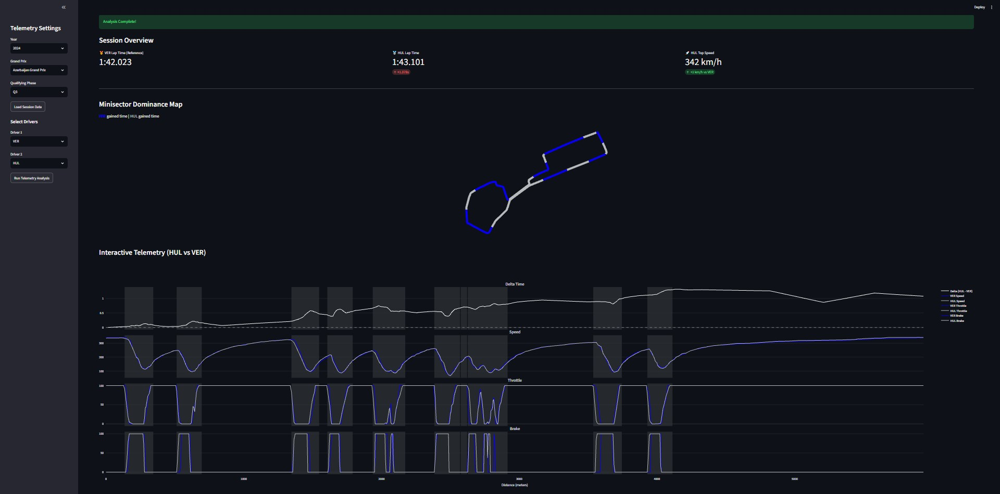
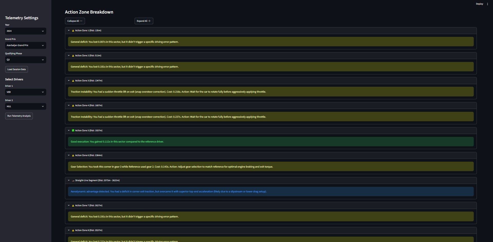

# F1 Telemetry Coach 🏎️

An advanced, interactive telemetry analysis dashboard built with Python and Streamlit. This tool acts as an automated Race Engineer by directly comparing the telemetry of two drivers, using the faster lap as a baseline "Reference". It analyzes F1 telemetry data from `fastf1` to provide quantitative, prescriptive coaching feedback for the "Comparison" driver.




## Features

- **Interactive Telemetry Dashboard:** 4-panel interactive Plotly charts (Delta, Speed, Throttle, Brake) with cross-hair hovering and zoom.
- **Minisector Dominance Map:** A true-to-life 2D track map dynamically colored by driver dominance to visualize who gained time where.
- **Automated Comparative Coaching Logic:** An advanced physics engine that scans the telemetry to detect driver errors and aerodynamics factors by directly comparing the two drivers' inputs, including:
  - **Overshooting:** Late braking and carrying too much entry speed relative to the reference driver.
  - **Trail Braking:** Analyzing the slope of brake release compared to the optimal reference lap.
  - **Snap Oversteer:** Identifying steering wheel reversals indicating traction loss.
  - **Aerodynamic Signatures:** Identifying when time gained on a straight was due to slipstream/tow vs a strong corner exit.
- **Dynamic Session Loading:** Easily switch between Grand Prix events, Qualifying sessions (Q1/Q2/Q3), and Drivers.
- **Official F1 Team Colors:** Dynamic team color rendering with intra-team clash prevention.

## Architecture

The project strictly separates data ingestion, physics processing, and the UI:
* `/data_ingestion/fetcher.py`: Wraps `fastf1` for caching and session data extraction.
* `/telemetry_engine/processing.py`: Handles spatial interpolation and delta time alignment across 25 micro-sectors.
* `/telemetry_engine/coaching_logic.py`: Evaluates physics derivatives to produce automated racing feedback.
* `/api/main.py`: Orchestrates the engine and data fetcher.
* `/frontend/dashboard.py`: Renders the UI using Streamlit and Plotly.

## Installation

1. Clone the repository.
2. Create a virtual environment:
   ```bash
   python -m venv .venv
   .\.venv\Scripts\activate
   ```
3. Install the dependencies:
   ```bash
   pip install -r requirements.txt
   ```

## Usage

Run the dashboard locally using Streamlit:
```bash
streamlit run frontend/dashboard.py
```
*Note: The first time you load a specific Grand Prix session, it may take 10-20 seconds to download the raw telemetry from the FastF1 cache.*

## Requirements

See `requirements.txt`. Built with:
- `fastf1`
- `streamlit`
- `plotly`
- `pandas`
- `numpy`
- `matplotlib`

## Disclaimer
This project is for educational and non-commercial purposes only. It is not affiliated with, associated with, or endorsed by Formula 1, the FIA, or any official Formula 1 teams. All telemetry data is fetched via the public API parsed by `fastf1`. All rights to the F1 data and trademarks belong to their respective owners.
